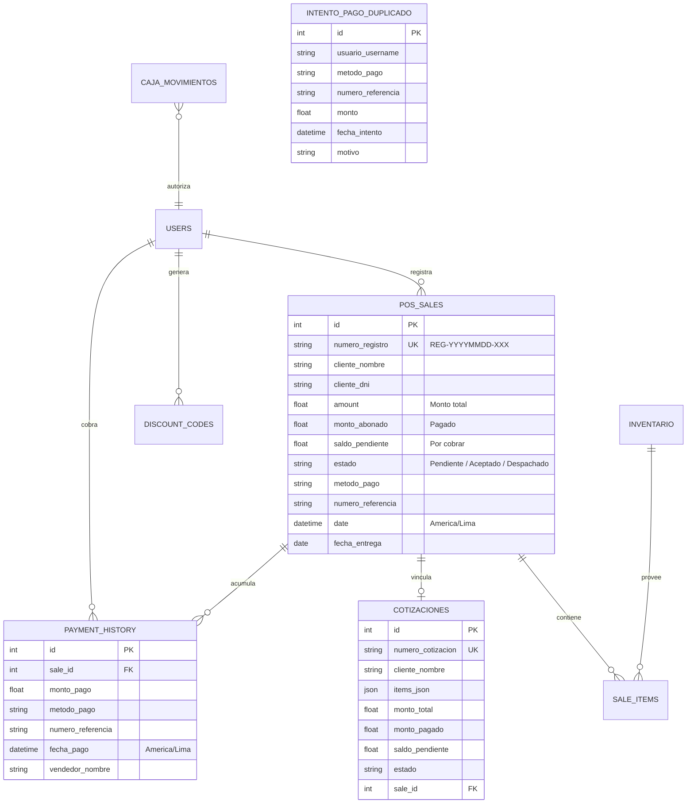

# 🌲 Lignum ERP — Sistema Integral de Gestión Maderera, Carpintería & Showroom WebXR 3D

> **Sistema Enterprise Premium** diseñado específicamente para el sector maderero, carpinterías industriales y distribuidores de tableros de melamina. Integra en una única plataforma desacoplada el ciclo comercial completo: Punto de Venta (POS), optimización algorítmica de cortes 2D para CNC, control de producción en taller, gestión de deudas con bloqueo financiero, arqueo de caja con horario oficial peruano, facturación electrónica SUNAT y visualización inmersiva 1:1 en Realidad Virtual (WebXR).

[](https://fastapi.tiangolo.com)
[](https://python.org)
[](https://supabase.com)
[](https://aframe.io)
[](https://www.sunat.gob.pe)
[](#-aseguramiento-de-calidad-y-auditoría)
[-blue)](https://www.iana.org/time-zones)

---

## 📑 Tabla de Contenidos

1. [🌟 Visión General y Propósito](#-visión-general-y-propósito)
2. [🏗️ Arquitectura y Stack Tecnológico](#️-arquitectura-y-stack-tecnológico)
3. [🚀 Módulos Funcionales y Funcionamiento Detallado](#-módulos-funcionales-y-funcionamiento-detallado)
   - [1. Punto de Venta (POS) & Venta Mostrador](#1-punto-de-venta-pos--venta-mostrador)
   - [2. Prevención Antifraude de N° de Operación Duplicado](#2-prevención-antifraude-de-n-de-operación-duplicado)
   - [3. Gestión de Códigos de Descuento de Un Solo Uso](#3-gestión-de-códigos-de-descuento-de-un-solo-uso)
   - [4. Gestión de Pedidos, Taller y Time-Boxing](#4-gestión-de-pedidos-taller-y-time-boxing)
   - [5. Regla Inviolable de Despacho (Bloqueo Financiero)](#5-regla-inviolable-de-despacho-bloqueo-financiero)
   - [6. Control de Caja y Arqueo con Horario Oficial de Perú](#6-control-de-caja-y-arqueo-con-horario-oficial-de-perú)
   - [7. Centro Tributario y Facturación Electrónica SUNAT](#7-centro-tributario-y-facturación-electrónica-sunat)
   - [8. Optimizador de Cortes 2D CNC (Bin Packing)](#8-optimizador-de-cortes-2d-cnc-bin-packing)
   - [9. Showroom Inmersivo WebXR 3D (Realidad Virtual 1:1)](#9-showroom-inmersivo-webxr-3d-realidad-virtual-11)
   - [10. Panel Administrativo, Métricas y Reportes con IA](#10-panel-administrativo-métricas-y-reportes-con-ia)
   - [11. Sistema de Impresión Térmica Continua 57mm](#11-sistema-de-impresión-térmica-continua-57mm)
4. [👥 Matriz de Seguridad y Permisos RBAC](#-matriz-de-seguridad-y-permisos-rbac)
5. [🗄️ Modelo de Datos y Entidades Principales](#️-modelo-de-datos-y-entidades-principales)
6. [🧪 Aseguramiento de Calidad y Auditoría](#-aseguramiento-de-calidad-y-auditoría)
7. [📐 Estándares de Ingeniería y Clean Code](#-estándares-de-ingeniería-y-clean-code)

---

## 🌟 Visión General y Propósito

**Lignum ERP** nace para resolver la alta complejidad operativa de los negocios madereros y talleres de melamina, donde conviven ventas de mostrador de tableros enteros, servicios especializados de corte y canteado al milímetro, fabricación a pedido de mobiliario personalizado y estrictas normativas tributarias.

### Retos Clave que Resuelve la Plataforma:
* **Cero Fugas Financieras:** Bloqueo estricto que impide entregar o despachar cualquier pedido que mantenga un saldo pendiente (`deuda > S/ 0.00`).
* **Protección contra Fraudes de Pago:** Detección en tiempo real de números de operación bancarios repetidos (Yape, Plin, Transferencias BCP/BBVA) para evitar capturas de pantalla reutilizadas.
* **Máximo Rendimiento de Material:** Algoritmo 2D que minimiza el desperdicio de planchas de melamina considerando el grosor de la sierra (*kerf* de 3mm) y la orientación de la veta de la madera.
* **Velocidad Extrema (Time-Boxing):** Arquitectura optimizada que carga por defecto únicamente los registros de los últimos 30 días, permitiendo expandir al historial completo con un solo clic sin saturar el navegador ni la base de datos.
* **Experiencia de Venta Inmersiva:** Visualización 3D WebXR para que los clientes revisen y aprueben sus muebles a escala real en Realidad Virtual antes de iniciar el corte.

---

## 🏗️ Arquitectura y Stack Tecnológico

La solución implementa una arquitectura desacoplada basada en microservicios modulares y una interfaz de usuario Single Page Application (SPA) sin sobrecarga de dependencias pesadas:

```
┌────────────────────────────────────────────────────────────────────────┐
│                        CAPA DE PRESENTACIÓN (SPA)                      │
│   HTML5 Semántico + Tailwind CSS + Vanilla JS (ES6+ Modular)           │
│   ├── Componentes Táctiles Mobile-First con Bottom Sheet en POS        │
│   ├── Visor WebXR Inmersivo 3D (A-Frame / Three.js)                    │
│   └── Motor de Impresión Térmica 57mm con jsPDF                        │
└───────────────────────────────────┬────────────────────────────────────┘
                                    │ REST API (JSON + JWT Bearer)
                                    │ CORS Seguro + Route Guards
┌───────────────────────────────────▼────────────────────────────────────┐
│                    CAPA DE SERVICIOS BACKEND (FastAPI)                 │
│   Python 3.10+ estructurado en Routers por Dominio de Negocio:         │
│   ├── /sales        -> Ventas rápidas, cuotas, métricas y time-boxing  │
│   ├── /quotes       -> Cotizaciones, kanban de taller y edición segura │
│   ├── /cortes       -> Motor de optimización de corte 2D Bin Packing   │
│   ├── /caja         -> Control de flujo diario, arqueo y métodos       │
│   ├── /facturacion  -> Emisión SUNAT, consulta RUC/DNI, UBL 2.1        │
│   ├── /impuestos    -> Compras, retenciones, cálculo IGV/Renta y SIRE  │
│   ├── /codigos      -> Descuentos criptográficos de un solo uso        │
│   └── /api/vr       -> Modelos 3D y sincronización de showrooms        │
└───────────────────────────────────┬────────────────────────────────────┘
                                    │ SQLAlchemy ORM + Connection Pool
┌───────────────────────────────────▼────────────────────────────────────┐
│                  CAPA DE PERSISTENCIA Y AUDITORÍA                      │
│   PostgreSQL en Supabase / SQLite Local + Logs de Trazabilidad         │
│   ├── Zona Horaria Oficial: America/Lima (UTC-5)                       │
│   └── Tablas relacionales con llaves foráneas e integridad referencial│
└────────────────────────────────────────────────────────────────────────┘
```

---

## 🚀 Módulos Funcionales y Funcionamiento Detallado

### 1. Punto de Venta (POS) & Venta Mostrador
Diseñado para operar a gran velocidad en el mostrador del taller, tanto desde ordenadores de escritorio como desde tablets y teléfonos móviles:
* **Catálogo Visual de Melaminas:** Selector con códigos de color oficiales por marca (Vesto, Pelíkano, Novopan, Masisa, Tableros Hispanos).
* **Venta Rápida Mixta:** Permite combinar productos terminados, planchas completas, medias planchas y servicios de taller (corte longitudinal, canteado delgado/grueso, ranurado, biselado y perforación de bisagras).
* **Modalidad de Pago Flexible:**
  * **Al Contado:** Pago total inmediato generando comprobante en un solo paso.
  * **Con Adelanto (Abono Parcial):** El cliente deja un monto inicial y el sistema calcula automáticamente el saldo pendiente y programa la fecha estimada de entrega.
  * **Sin Adelanto:** Generación de orden de cotización con saldo 100% por cobrar.
  * **Pagos Mixtos:** Soporta fraccionar una sola venta en múltiples métodos (ej. S/ 100 en Efectivo + S/ 150 en Yape).

### 2. Prevención Antifraude de N° de Operación Duplicado
Para proteger el negocio frente a clientes que presentan comprobantes digitales falsificados o capturas de transferencias ya utilizadas:
* Cada vez que se registra un pago electrónico (Yape, Plin, BCP, BBVA, Interbank), el sistema verifica en tiempo real que el **Número de Referencia / Operación** no haya sido ingresado previamente para ese método de pago.
* Si se detecta una coincidencia:
  1. Se **bloquea inmediatamente la transacción**.
  2. Se registra el incidente en la tabla de **Auditoría de Intentos Duplicados** (capturando hora exacta, usuario que intentó la acción, monto y pedido).
  3. Se notifica a la pantalla de Jefatura mediante un badge de advertencia.

### 3. Gestión de Códigos de Descuento de Un Solo Uso
Mecanismo de fidelización y promociones con control de seguridad absoluto:
* Exclusivo para el rol **Jefa**: puede generar cupones alfanuméricos con monto fijo en soles (ej. `DESC-99X9VN` por S/ 25.00), especificando si aplica a todo el pedido o a un producto/marca en específico.
* **Consumo Atómico:** Una vez que una vendedora aplica el cupón en el POS y se concreta la venta, el código queda marcado automáticamente como `usado=True`, registrando la fecha y el ID de la venta en la que se redimió. Es imposible reutilizarlo.

### 4. Gestión de Pedidos, Taller y Time-Boxing
El núcleo operativo de la carpintería donde el personal de ventas y los carpinteros sincronizan el estado de cada trabajo:
* **Tablero Operativo por Estados:**
  * 🟡 **Pendiente:** Cotizaciones recibidas que requieren revisión o abono inicial.
  * 🔵 **Aceptado / En Producción:** Pedido en corte y enchape en taller.
  * 🟠 **Por Despachar:** Pedido 100% fabricado listo para entrega. Cuenta con el botón **"Detalles"** que despliega el desglose pormenorizado de piezas, planchas y servicios para que el despachador verifique el material físicamente antes de cargarlo.
  * 🟢 **Despachado:** Trabajo entregado a conformidad del cliente.
* **Carga Ultrarrápida con Time-Boxing:** Por defecto, la pantalla carga únicamente los pedidos de los **últimos 30 días**, evitando que la interfaz se congele con miles de filas históricas. Un botón amigable permite consultar el historial completo si se necesita buscar una venta antigua.
* **Modo Edición Integral:** Permite modificar un pedido ya guardado (agregar piezas, cambiar cliente, recalcular abonos) sin duplicar registros, actualizando tanto la cotización como su venta vinculada en una sola transacción atómica.

### 5. Regla Inviolable de Despacho (Bloqueo Financiero)
Una de las protecciones más estrictas del ERP:
* Ningún usuario (incluso administradores) puede marcar un pedido como **"Despachado"** si tiene saldo pendiente (`saldo_pendiente > 0.00`).
* Al intentar despachar un pedido con deuda, el sistema bloquea la acción y abre automáticamente el **Modal de Cancelación de Saldo**, solicitando registrar el pago restante, su método y su número de operación.
* Una vez cobrado el 100%, se emite el **Recibo de Cancelación Total** y recién se habilita el botón de entrega.

### 6. Control de Caja y Arqueo con Horario Oficial de Perú
Módulo financiero para el control estricto del efectivo y saldos bancarios:
* **Zona Horaria Estricta:** Integración con `America/Lima` (UTC-5), garantizando que las ventas nocturnas y los cierres de turno de sábado o domingo se imputen a la fecha exacta de Perú, sin desfases por servidores en el extranjero.
* **Arqueo en Vivo:** Desglose en tiempo real de ingresos por método: Efectivo en caja física, saldo en billeteras digitales (Yape/Plin) y cuentas bancarias (BCP/BBVA).
* **Control de Movimientos:** Registro categorizado de ingresos y egresos (gastos de taller, compras menores, viáticos, pagos a proveedores).

### 7. Centro Tributario y Facturación Electrónica SUNAT
Módulo especializado para el cumplimiento de las normativas tributarias peruanas:
* **Tipos de Comprobante:** Emisión de Boleta Electrónica (`03`), Factura Electrónica (`01`) y Notas de Venta internas.
* **Cálculo Automático de Impuestos:** Base imponible, IGV (18%) y monto total calculados matemáticamente sin errores de redondeo.
* **Regímenes Tributarios:** Soporte configurado para Régimen Especial de Renta (RER - 1.5%) y Régimen MYPE Tributario (RMT).
* **Generación SIRE:** Preparación de propuestas de compras y ventas compatibles con el Sistema Integrado de Registros Electrónicos (SIRE) de la SUNAT.

### 8. Optimizador de Cortes 2D CNC (Bin Packing)
Herramienta de ingeniería industrial para el taller de despiece:
* **Algoritmo de Empaquetamiento Bidimensional:** Recibe la lista de piezas solicitadas por el cliente (ancho, largo, cantidad) y las distribuye de manera óptima sobre planchas estándar de melamina (ej. 2440 × 2140 mm o 2440 × 1830 mm).
* **Consideración de Espesor de Sierra (Kerf):** Descuenta automáticamente 3 mm por cada pasada de corte de la seccionadora o escuadradora.
* **Sentido de Veta:** Respeta la orientación del diseño de la madera para evitar que las piezas queden con las vetas desalineadas.
* **Exportación de Datos:** Genera archivos compatibles con software de control numérico CNC y formatos estructurados `.csv` y `.cut`.

### 9. Showroom Inmersivo WebXR 3D (Realidad Virtual 1:1)
Diferenciador comercial que eleva la tasa de cierre de ventas:
* Construido con tecnologías web abiertas (WebXR, A-Frame y Three.js).
* Permite al cliente colocarse gafas de Realidad Virtual (Meta Quest, HTC Vive) o interactuar desde el celular/PC para caminar dentro de un salón virtual y examinar el mobiliario diseñado a escala real 1:1.
* El cliente puede abrir puertas de closets, inspeccionar cajones, probar acabados de melamina y aprobar el diseño final antes de enviar las planchas a corte.

### 10. Panel Administrativo, Métricas y Reportes con IA
Centro de comando para la gerencia y jefatura:
* **Métricas Financieras Interactivas:** Filtros de tiempo dinámicos para visualizar Ingresos y Saldos por Cobrar:
  * 📅 **Hoy:** Transacciones desde las 00:00 del día.
  * 📆 **Esta Semana:** Acumulado de la semana en curso (lunes a domingo).
  * 🗓️ **Este Mes:** Ingresos del mes actual.
  * ⏪ **Mes Anterior:** Comparativa con el mes cerrado previo.
  * 🌐 **Histórico Total:** Acumulado histórico completo consolidando cuotas y ventas directas.
* **Reporte Diario Asistido por IA (Gemini):** Síntesis automatizada que analiza la recaudación del día, alerta sobre pedidos retrasados en taller, detecta clientes con deudas vencidas y sugiere reposición de tableros con stock bajo.

### 11. Sistema de Impresión Térmica Continua 57mm
Generador vectorial de comprobantes físicos en rollo térmico estándar (57 mm / 58 mm):
* **Ticket Triple en un Solo Rollo:**
  1. **Comprobante de Venta:** Boleta SUNAT o Nota de Pedido con desglose de ítems, totales, abonos y saldo restante.
  2. **Nota de Entrega / Despacho:** Copia para control en puerta de salida del almacén.
  3. **Orden de Taller (Hoja de Ruta):** Detalle técnico para los operarios de carpintería con medidas exactas de piezas, tipos de tapacanto (delgado de 0.45mm o grueso de 3mm) y observaciones de armado.

---

## 👥 Matriz de Seguridad y Permisos RBAC

El sistema implementa una **doble barrera de seguridad** (validación en backend mediante dependencias FastAPI + ocultamiento/eliminación estricta de elementos en el DOM mediante JavaScript):

| Módulo / Función | 👑 JEFA | 🏢 ENCARGADA | 📐 ARQUITECTO | 💼 VENDEDORA | 🪚 CARPINTERO |
|---|:---:|:---:|:---:|:---:|:---:|
| **Punto de Venta (POS)** | ✅ Total | ✅ Total | ✅ Total | ✅ Total | ❌ Denegado |
| **Gestión de Pedidos (Taller)** | ✅ Total | ✅ Total | ✅ Total | ✅ Total | ✅ Solo Lectura |
| **Despacho de Pedidos** | ✅ Total | ✅ Total | ✅ Total | ✅ Total | ❌ Denegado |
| **Cobro de Saldos / Cuotas** | ✅ Total | ✅ Total | ✅ Total | ✅ Total | ❌ Denegado |
| **Control de Caja y Arqueo** | ✅ Total | ❌ Bloqueado | ❌ Bloqueado | ❌ Bloqueado | ❌ Bloqueado |
| **Centro Tributario (Impuestos)** | ✅ Total | ❌ Bloqueado | ❌ Bloqueado | ❌ Bloqueado | ❌ Bloqueado |
| **Visor 3D WebXR** | ✅ Total | ✅ Total | ✅ Total | ❌ Denegado | ❌ Denegado |
| **Gestión de Usuarios** | ✅ Total | ❌ Bloqueado | ❌ Bloqueado | ❌ Bloqueado | ❌ Bloqueado |
| **Inventario y Precios** | ✅ Total | ❌ Bloqueado | ❌ Bloqueado | ❌ Bloqueado | ❌ Bloqueado |
| **Generar Cupones Descuento** | ✅ Total | ❌ Bloqueado | ❌ Bloqueado | ❌ Bloqueado | ❌ Bloqueado |
| **Auditoría de Pagos Duplicados**| ✅ Total | ✅ Total | ✅ Total | ❌ Denegado | ❌ Denegado |

---

## 🗄️ Modelo de Datos y Entidades Principales



---

## 🧪 Aseguramiento de Calidad y Auditoría

La confiabilidad del sistema está respaldada por una batería automatizada de **39 pruebas unitarias, de integración y de seguridad**:

* **Suite de Seguridad y Control de Acceso RBAC (15 Pruebas):**
  * Validación de tokens JWT adulterados, expirados o ausentes.
  * Bloqueo estricto de endpoints financieros (Caja e Impuestos) para usuarios no administradores.
  * Rechazo de creación de usuarios por roles no autorizados.
* **Suite de Funcionamiento y Lógica de Negocio (11 Pruebas):**
  * Control de stock en inventario y rechazo por existencias insuficientes.
  * Procesamiento de ventas con pago al contado, adelantos y saldos.
  * Consistencia matemática de totales e impuestos.
* **Suite de Prevención de Fraudes:**
  * Bloqueo inmediato al intentar registrar un N° de Operación duplicado en pagos electrónicos.
  * Persistencia en el log de auditoría para revisión de Jefatura.
* **Suite de Time-Boxing y Rendimiento:**
  * Filtro por defecto de 30 días en Cotizaciones, Caja e Impuestos.
  * Expansión a historial completo bajo el parámetro `?all=true`.
  * Límite de las 30 ventas más recientes en el Panel General con carga bajo demanda.

---

## 📐 Estándares de Ingeniería y Clean Code

El código fuente sigue rigurosamente las mejores prácticas de la industria:
* **Single Responsibility Principle (SRP):** Cada módulo, router y función cumple un único propósito bien delimitado.
* **Tipado Estático Riguroso (Type Hinting):** Todas las funciones de Python cuentan con anotaciones de tipo explícitas para parámetros y retornos (`def calcular_totales(db: Session) -> Dict[str, float]:`).
* **Estándar PEP 8:** Convenciones de nomenclatura estrictas (`snake_case` para variables y funciones, `PascalCase` para clases y modelos ORM).
* **Trazabilidad Profesional (Logging):** Prohibido el uso de `print()` en producción; toda la actividad relevante se canaliza mediante el módulo estándar `logging` con niveles `INFO`, `WARNING` y `ERROR`.
* **Eficiencia Matemática con Pandas:** Prohibida la iteración fila por fila con `iterrows()`; todas las agregaciones de compras y ventas tributarias se procesan de forma vectorizada nativa.
* **Manejo Seguro de Errores:** Bloques `try...except` capturando excepciones específicas (`SQLAlchemyError`, `RequestException`), garantizando que la base de datos nunca quede en estados inconsistentes.

---

## 📄 Licencia y Mantenimiento

Desarrollado como solución corporativa para **Lignum ERP**.

Sistema en producción activa — arquitectura diseñada y mantenida para alta disponibilidad comercial y operativa en carpinterías y centros de corte de melamina.
